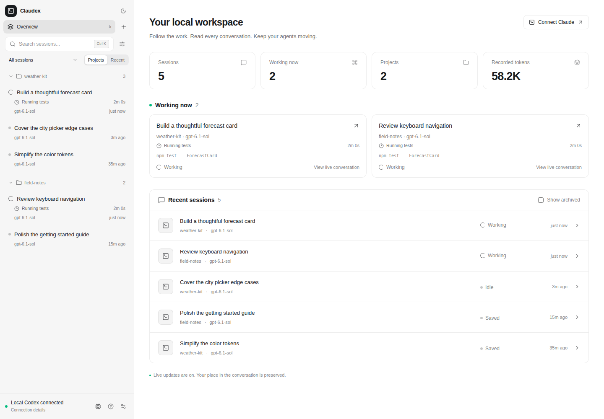
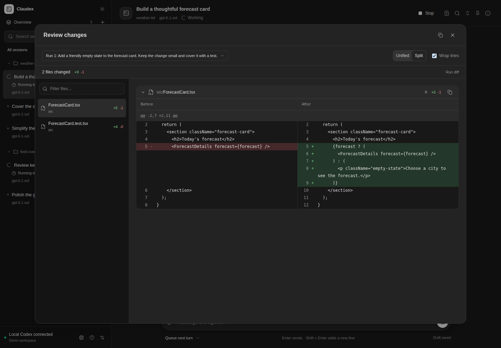

# Claudex

**Codex agents for Claude Code.**

[](https://github.com/danielasher115/claudex/actions/workflows/ci.yml)
[MIT license](LICENSE)

Give Claude Code a crew of Codex agents, then follow their work in a local dashboard. Read conversations, inspect changes,
steer a running agent, and keep the caller's instructions and context visible in one place.

Claudex is an independent community project. It is not an official OpenAI or Anthropic product.



Watch real Claude Code delegations: **[launch and collect](docs/videos/launch-and-collect.webm)** and
**[queue and steer](docs/videos/queue-and-steer.webm)**. [Recordings and transcripts](docs/videos/README.md).

## What you get

- **One workspace for your agents.** Live activity, searchable conversations, project groups, pinned sessions, and saved history.
- **Control while work is happening.** Queue a follow-up, steer the current turn, stop an agent and its delegated children, or resume saved work.
- **A reviewable handoff.** Read messages and tool output, inspect per-run unified or split diffs, and preview supported attachments.
- **Context you can inspect.** See inherited instructions, memories, skills, model settings, and the runtime's available integrations.
- **One gateway for every caller.** The dashboard, CLI, MCP clients, and agent delegation tools share the same local state and delivery rules.

## Quick start

You need Python 3.11+, an installed and authenticated Codex CLI with app-server support, and Claude Code if you want Claude to delegate.
Codex access and model usage are provided by your own Codex installation and account.

Install from GitHub with [pipx](https://pipx.pypa.io/stable/installation/):

```bash
pipx install git+https://github.com/danielasher115/claudex.git
```

There is no PyPI release to install. The repository includes the built dashboard, so Node.js is only needed for UI development.

### Windows PowerShell

Start Codex in one terminal and leave it running:

```powershell
codex app-server --listen ws://127.0.0.1:4500
```

In a second terminal:

```powershell
claudex start --codex-url ws://127.0.0.1:4500
claudex status
```

### Linux and WSL

If your Codex installation already provides its local control socket, use it directly:

```bash
claudex start
claudex status
```

For a standalone app-server, start your own Unix socket in another terminal:

```bash
codex app-server --listen unix:///tmp/claudex-codex.sock
```

Then connect to it:

```bash
claudex start --socket /tmp/claudex-codex.sock
```

Open **[codex.localhost:8765](http://codex.localhost:8765)**. The public local address stays stable while the backend selects a free port.
`claudex status` prints the current address and connection details. Stop the gateway with `claudex stop`.

Linux/WSL and native Windows are validated by the test suite, with Python 3.11 and 3.13 checked in CI. macOS is untested.
See [setup and troubleshooting](docs/setup.md) for platform details, custom ports, and data locations.

### Connect Claude Code

Keep Claudex running and add this stdio MCP server to your Claude Code configuration:

```json
{
  "mcpServers": {
    "codex": {
      "command": "claudex",
      "args": ["mcp"]
    }
  }
}
```

The server name `codex` matches the optional caller-context hook. Use the same user and data directory as the dashboard.
The app's **Connect Claude** dialog also shows the configuration for your running instance.

For automatic export of the launching Claude conversation, install the context hook:

```bash
claudex install-claude-context
```

This updates your Claude user settings and preserves a backup. Restart or resume Claude Code and reconnect its Codex MCP server.
Without the hook, agents can still launch; you can pass a `session_summary` for the handoff.
For Claude on Windows talking to Claudex inside WSL, see the [WSL MCP configuration](docs/setup.md#windows-claude-with-a-wsl-gateway).

## Real CLI walkthroughs

These clips record real Linux Claude Code print-mode runs against a dedicated local Claudex gateway and real Codex workers.
The terminal display comes from actual public text and tool receipts. Output is paced for reading, idle gaps are shortened,
and tool receipts show selected actual fields. The original transcript is linked beside each clip.

[**Watch Claude launch a Codex worker and collect its result**](docs/videos/launch-and-collect.webm) (49 seconds, 1.2 MB).
The worker changes a small Python function, adds an assertion, and runs pytest. Claude retrieves its completed result.

[](docs/videos/launch-and-collect.webm)

[**Watch queue and steer reach a running worker**](docs/videos/queue-and-steer.webm) (64 seconds, 1.4 MB).
The receipts show a queued follow-up and a delivered steer bound to the active turn. The current report includes the steering marker;
the queued follow-up completes in a separate turn. A deliberate 25-second sleep leaves time to demonstrate delivery.

[Both previews, original timed casts, and readable transcripts](docs/videos/README.md) are included. Account banners, credentials,
and real user conversations are excluded. [Recording instructions](docs/development.md#record-a-real-claude-cli-walkthrough).

## See the work

Read the conversation and send a follow-up while the agent works:


Review the recorded changes in a split diff:



Inspect the instructions and execution settings behind an agent:


All screenshots render the real frontend with fictional, local demo fixtures. No real conversations or account data are included.
[Regenerate the screenshots](docs/development.md#demo-screenshots) without starting Codex or making model requests.

## Use it from the CLI

```bash
claudex models
claudex call agents.list --json -
```

For the second command, supply a JSON object on stdin, such as `{}`. For a launch, save the request below as `request.json`,
replace the workspace path with your project, and run `claudex call agents.launch --json request.json`:

```json
{
  "prompt": "Review the project and report the most useful small improvement.",
  "cwd": "/absolute/path/to/project",
  "name": "Project review",
  "sandbox": "workspace-write"
}
```

The launch returns a thread ID immediately. Use `agents.status`, `agents.wait`, and `agents.result` to follow it.
See the [agent protocol](docs/agent-protocol.md) for attachments, exact message targeting, retries, and child agents.

## Local by design

Claudex listens on loopback and uses your local Codex app-server. It stores gateway state, prepared attachments, and a local
protocol token in your user state directory. Set `CLAUDEX_DATA_DIR` or pass `--data-dir` to select another instance.
Claudex does not include Codex credentials or host a model service.

Treat the dashboard and MCP connection as access to your local coding agents. Keep them private. Context inheritance can include
project instructions, memories, and public caller history. Native Codex sandbox and approval policy remain authoritative.
Read [security](SECURITY.md) before changing how the gateway is exposed.

## Development and documentation

```bash
git clone https://github.com/danielasher115/claudex.git
cd claudex
python -m venv .venv
# Activate .venv for your shell, then:
python -m pip install -e '.[dev]'
```

UI dependencies are installed separately: run `npm ci` in `ui/`, then `npm run build` to rebuild the packaged dashboard.
See [development](docs/development.md) for checks and demo screenshots.

- [Setup, platform notes, and troubleshooting](docs/setup.md)
- [Agent protocol and context inheritance](docs/agent-protocol.md)
- [Architecture and change paths](docs/architecture.md)
- [Delegated thread lifecycle](docs/thread-lifecycle.md)
- [Contributing](CONTRIBUTING.md) and [security policy](SECURITY.md)

Licensed under the [MIT License](LICENSE).
