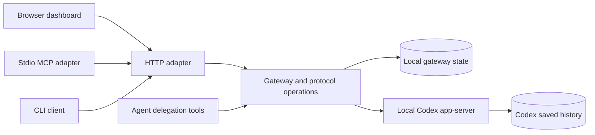

# Architecture

Claudex has one local gateway and several ways to call it. The useful boundary is an agent operation such as launch, send, wait,
or result. Callers should not need to coordinate thread state, native RPC, queued delivery, context policy, or retry ownership themselves.

The browser uses same-origin dashboard endpoints and server-sent events. CLI and MCP adapters use the authenticated local protocol.
Gateway-owned native delegation tools call the same operation layer. Codex remains responsible for model execution, its sandbox,
approvals, saved native threads, and its runtime integrations.

## Boundaries that hide policy

| Boundary | What callers ask for | Details owned behind it |
| --- | --- | --- |
| Gateway lifecycle | Run a connected local gateway | Background workers, reconciliation, queue processing, and cleanup |
| Protocol operations | Launch, send, wait, cancel, result | Request validation, exact target ownership, receipts, and delivery state |
| Context inheritance | Prepare the caller context | Instruction discovery, import trust, snapshots, supported settings, and provenance |
| Artifact preparation | Prepare an attachment | Format detection, extraction, size limits, rendered pages, and immutable IDs |
| Native transport | Call a Codex RPC method | Unix/WebSocket framing, correlation, notifications, connection state, and reconnect handling |
| Recorded session view | Read history and details | Saved-history sources, pagination, transcript normalization, and recorded/current distinctions |

Python source lives in `codex_sessions/`; the public command is `claudex`.

`Gateway.running` is the lifecycle boundary for the connected service. HTTP setup delegates service startup and cleanup to it.
The server adapter translates requests and responses; it should not require callers to reproduce worker orchestration.
`protocol.py` is the public operation boundary, while delivery, turns, context, artifacts, and lifecycle modules hold their respective policies.
The React frontend in `ui/` consumes the HTTP contract, and its built assets ship with the Python package.

## Trace one operation

For a launch, the caller supplies a task, workspace, optional attachments, and context preferences. The gateway validates the request,
prepares inputs, records ownership and its idempotency key, and asks Codex to start the thread and first turn.
It returns the thread ID before generation finishes. Notifications and reconciliation update the same local state the dashboard reads.
A follow-up reuses that thread through the delivery worker; a retry reuses its receipt rather than launching unrelated work.

Agent completion and idle release are different events. The lifecycle policy releases only the gateway's subscription after pending
work is gone. Codex decides when to unload its runtime resources, while recorded history stays readable.

## Where a change belongs

Change a delivery rule where queue/steer targeting and receipts are decided, then verify it through the protocol boundary.
Change context trust where imports and source provenance are resolved, so every caller receives the same policy.
Add a supported attachment format inside preparation, keeping upload callers format-agnostic. Extend a UI view by consuming recorded
or current data from the session adapter rather than teaching the browser how native history is stored.

A new file is useful when it owns a meaningful policy behind a small interface. Avoid adding wrappers that only forward arguments
or expose orchestration steps for every caller to sequence. Small functions and many files do not by themselves produce deep modules.
Keep normal changes on one policy path and use adapters to preserve the public contract.

## State and privacy

Gateway state belongs in the user state directory, separate from the installation and Codex home. Runtime discovery lets MCP and CLI
find the same gateway even when its backend port changes. The browser address uses a separate stable loopback listener.

The context boundary distinguishes trusted user rules from project content. Native permission policy remains authoritative.
See [the protocol](agent-protocol.md#caller-context) for exact import behavior and [security](../SECURITY.md) before exposing local endpoints.

## Design references

The module boundaries follow information hiding: callers choose an intent-level operation, and its owner handles sequencing,
validation, state transitions and cleanup. A large coherent module can be preferable to several forwarding layers. Change coupling
and boundary tests matter more than file counts.

- [Ilya Isaev: Deep Modules and Information Hiding](https://ilyaisaev.com/blog/deep-modules-why-information-hiding-is-the-ultimate-interface-for-ai/)
- [Khairold: Deep modules for AI agents](https://www.khairold.com/systems/deep-modules-for-agents)
- [John Nye: Applying Deep Modules to a Small Codebase](https://www.jnye.co/posts/2061/deep-modules-small-codebase)
- [Maxim Saplin: Debloating the AI-Grown Codebase](https://dev.to/maximsaplin/debloating-the-ai-grown-codebase-2om)
